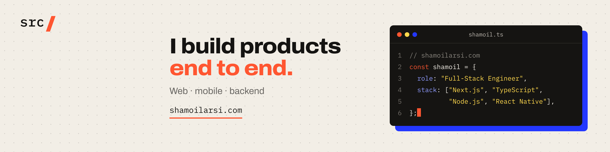

Full-stack engineer based in Mumbai. I build web products end to end, from schema to UI, and stay responsible for them once they're live. I've worked remotely with US and UK startup teams since 2020.
 
### Currently
 
**[Ren Protocol](https://renprotocol.org)**: sole backend engineer on a four-person team. I run the Bun API server, PostgreSQL schema, REST and WebSocket APIs, and a real-time indexing pipeline into PostgreSQL and ClickHouse. Before that, I spent two years on the frontend.
 
**[Bandit Brothers](https://www.banditbrothers.in)**: an apparel brand I co-founded and built the tech for, end to end. It runs on a Next.js storefront and admin, server-priced Razorpay checkout and per-size stock. It has had 10,000+ visitors.
 
### Previously
 
**[SPPU Question Papers](https://github.com/shamoilarsi/SPPU-Question-Papers-Android)**: an offline-first Android app for university exam papers. 130,000+ downloads.
 
**Open source**: fixes merged into [webpack](https://github.com/webpack/webpack) and [bitcoinjs/tiny-secp256k1](https://github.com/bitcoinjs/tiny-secp256k1).
 
### Stack
 
TypeScript · React · Next.js · React Native · Node.js · Bun · Python · PostgreSQL · ClickHouse · Redis · Firebase · Vercel · AWS
 
---
 
[shamoilarsi.com](https://shamoilarsi.com/?utm_source=github) · [LinkedIn](https://www.linkedin.com/in/shamoilarsi) · [hi@shamoilarsi.com](mailto:hi@shamoilarsi.com)
 